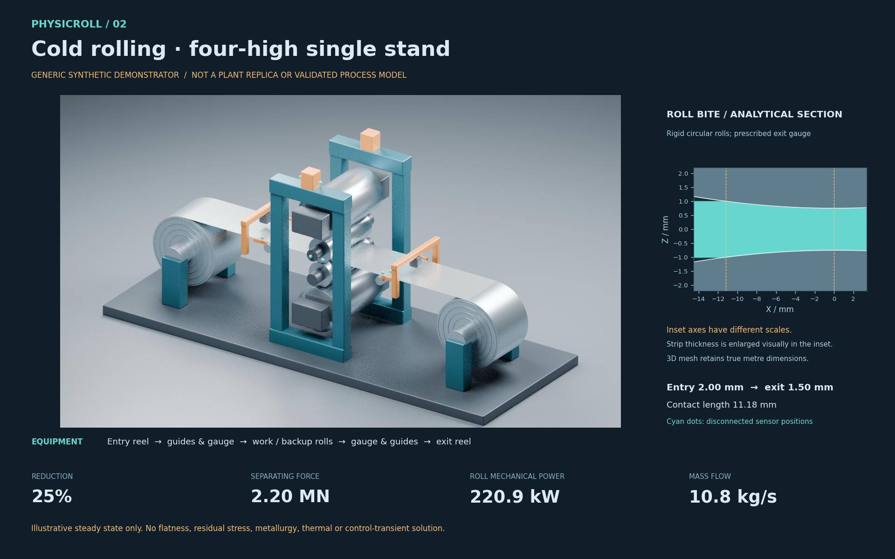

# PhysicRollModel

This repository (Python package `physicroll`) has two parts:

- **The core rolling demonstrator and its checked workflows.** A generic, synthetic four-high
  aluminium cold rolling demonstrator: an independent Python process model for the steady roll
  bite, disconnected sensor/equipment bookkeeping, parametric Blender equipment, an editable
  scene and portable USD geometry, plus checked workflows, saved runs, a guided editor and
  bounded transient transport/reel mechanics.
  Status: an initial digital-twin prototype, **not a plant replica or validated production
  model**. The core includes no actual material/plant data, live connections or production
  setpoints.
- **The band screening tool for thin-gauge aluminium (strip and foil)**, including EV battery
  collector foil. It takes a JSON case (what the bands look like, the pass, the mill),
  simulates candidate mechanisms, ranks twenty candidate causes in two families (lengthwise
  bands at fixed width positions; transverse marks) and writes an HTML report and a JSON
  result. It comes with a literature catalogue of thin-gauge products, a product survey, a
  process-temperature check and a literature gap study.
  Status: a screening tool on synthetic, uncalibrated models; **nothing in it has been
  validated against plant data**.

The **9 November 2026 development checkpoint** brings the checked workflows,
saved runs, guided editor and bounded transient transport/reel mechanics onto
`main`. Full v1 remains in development; the
[checkpoint decision](docs/v1-scope-amendment-2026-10-10.md) and
[integration critical path](docs/v1-integration-critical-path.md) record the
remaining physics, animation and release gates. The band screening work was merged
to `main` on 19 November 2026.



## Which part do I need?

| I want to ... | Go to |
|---|---|
| answer a few questions in the browser and see which causes fit, without editing a case file | [Guided app](#guided-app) |
| find likely causes for bands or marks I have on strip or foil, from a case file | [Band screening: quick start](#band-screening-quick-start) |
| look up product, alloy and temper data for thin-gauge aluminium | [Product, alloy and temper lookups](#product-alloy-and-temper-lookups) and [thin-gauge products](docs/thin-gauge-products.md) |
| use the steady process model, saved runs, the editor or the Blender scene | [Core demonstrator: start here](#core-demonstrator-start-here--no-dependencies-or-blender-needed) |
| know what the simulation does not cover yet | [Simulation coverage gaps](docs/simulation-coverage-gaps.md) and [Status and limits](#status-and-limits) |

## Band screening: quick start

### Requirements

Python 3.10+ and the standard library only; nothing to install. Run the commands from this
directory.

### Run a demo

```bash
python -m physicroll.band_cli scenarios/band_diagnosis_battery_foil.json --out my_demo
```

This is the battery-foil demo (synthetic). It takes about a minute and prints the ranked
standings. It writes two files into the `--out` directory, named after the case:
`<name>.result.json` (here `battery-foil-demo.result.json`) and `<name>.report.html`
(`battery-foil-demo.report.html`). The same files, already generated, are in
`artifacts/band_diagnosis/`. The other three demos are listed under [Demos](#demos).

### Guided app

```bash
python -m physicroll.band_app --runs-dir band-app-runs
```

Or double-click `start-band-app.bat` (Windows), `start-band-app.command` (macOS) or
`start-band-app.sh` (Linux). A page opens in your browser, on this computer only. It asks three
short sets of questions (what you see, what you are rolling, your mill), with "don't know" as
the default answer, runs the screening, and shows the shortlist of causes that fit, where the
bands sit against the coolant nozzles, and what to check next. Answering one of the checks
updates the shortlist and shows what changed. The result is a screening shortlist from a model
that has not been compared with plant data, and its trust level stays low until your own mill
values are entered. See [the band app guide](docs/band-app.md).

### Use it on your own case

1. Copy the template:

   ```bash
   cp scenarios/band_diagnosis_template.json my_case.json
   ```

2. Fill in the observations under `observation`: what was actually seen on the strip (for
   example `orientation`, `band_positions_across_width_m`, `lengthwise_continuity`,
   `appearance`). Leave `null` what nobody has looked at. A `null` never counts against a
   cause. The `notes` in the template explain every field.
3. Put in the pass (`pass`, and `schedule` for the other passes) and the mill values (`stand`,
   `spans`, `kinematics`, `coolant`, `width_model` and the other sections). Use SI units; most
   key names end in their unit, for example `exit_thickness_m` or `exit_tension_pa`. The
   values in the template are the synthetic demo mill, not your mill. Which keys are the
   machine, the product and the observations is listed in section 5.3 of
   [band diagnosis](docs/band-diagnosis.md).
4. Run it:

   ```bash
   python -m physicroll.band_cli my_case.json --out my_output
   ```

5. Open `my_output/<name>.report.html` in a browser.

### How to read the report

- Start with three sections: "Leading hypotheses" (the candidate causes the observations
  support, with what supports and contradicts each), "Next measurements" (the tests that
  would separate the remaining candidates) and "Limitations and sources".
- The score is an **ordinal evidence tally, not a probability**. A higher score means more
  weighted agreement with the observations as entered, not a stated likelihood.
- Flags say how far to trust a number. For example: `BITE_FROM_EXPERIMENTAL_MATTRESS_MODEL`
  (the roll bite comes from the experimental foil model, an order of magnitude only),
  `CHATTER_NOT_RELIABLE_ABOVE_SPAN_WAVE_LIMIT` (the model chatter frequency lies above the
  span-wave limit, so the chatter speed margin is not used as evidence) and
  `USER_SUPPLIED_INPUTS_NOT_VERIFIED` (a case with `synthetic: false`: the tool has not
  checked your inputs).
- Every result carries the status `SCREENING_RESULT_NOT_PLANT_VALIDATED`.

Section 12 of [band diagnosis](docs/band-diagnosis.md) describes every part of the report.

If the case describes the mill's shapemeter (`measurement.shapemeter`: zone width and count),
the report also shows what each zone would read for every modelled band, with a table of how
much a band narrower than a zone is diluted. These are zone means of the model, not a forecast
of the shapemeter screen: no flatness controller is modelled (section 7.6 of the guide).
A supplied strip temperature scan across the width (`width_model.strip_temperature`) adds
the flatness a shapemeter measures hot beside the flatness after cooling (section 7.7).

### Product, alloy and temper lookups

```bash
python -m physicroll.band_products --list
python -m physicroll.band_products --grades battery_collector_foil --gauge-um 18
python -m physicroll.band_products --temperatures
```

- `--list` prints the 27 catalogue product ids with their group and name.
- `--grades battery_collector_foil --gauge-um 18` prints the alloy and temper options for that
  gauge band with their evidence ratings, and a standard and a high-strength proposal (a
  literature proposal to confirm with the plant).
- `--temperatures` prints the literature map of process temperatures in foil rolling, with
  limits and source ids.

The full catalogue is in [thin-gauge products](docs/thin-gauge-products.md).

### Screening several products, also on your own mill

The product survey screens one synthetic final pass per catalogue product. Without options it
uses the two demo mills; `my_mill.json` below is a v2 case file of your mill (a copy of the
template with your machine values, a `width_model` and `model_options.bite_response_override`
set to `null`). Only its machine keys are used. Fill in `width_model.coil` and
`width_model.deflector_roll_radius_m` (both `null` in the template) to get the coil-ridge and
roller-wrinkle thresholds; without them the survey reports those two as not assessable.

```bash
python -m physicroll.band_survey --out my_survey
python -m physicroll.band_survey --out my_survey --mill my_mill.json
python -m physicroll.band_survey --out my_survey --foil-mill scenarios/band_diagnosis_battery_foil.json --sheet-mill my_mill.json
python -m physicroll.band_survey --out my_survey --mill my_mill.json --products battery_collector_foil,household_foil,litho_sheet
python -m physicroll.band_survey --out my_survey --mill my_mill.json --products battery_collector_foil,household_foil --overrides scenarios/band_survey_overrides_example.json
python -m physicroll.band_survey --out my_survey --mill my_mill.json --products battery_collector_foil,litho_sheet --write-cases my_cases
python -m physicroll.band_cli my_cases/litho_sheet.case.json --out my_output
```

- `--mill` uses one file for both gauge classes; `--foil-mill` (exit gauge below 0.2 mm) and
  `--sheet-mill` (0.2 mm and above) supply them separately.
- `--products` takes catalogue ids from `--list`.
- `--overrides` replaces survey-pass values per product with your own
  (`{"product_id": {"key": value}}`).
- `--write-cases` writes one ready-to-edit case file per product (every observation `null`).
- `python -m physicroll.band_cli --product-survey --out my_survey` runs the same survey and
  passes these options on.

Section 5.3 of [band diagnosis](docs/band-diagnosis.md) explains each option and which keys
are taken from your file.

### Where to read more

| Path | What it is |
|---|---|
| [`docs/band-diagnosis.md`](docs/band-diagnosis.md) | The guide: battery foil first (section 3), how to run (4), filling in the template and using your own mill (5, 5.3), evidence rules (6), equations with source tags (7-11), how to read the report (12), limitations (14) |
| [`docs/band-app.md`](docs/band-app.md) | The guided app: starting it, the three steps, how to read each picture, quick and detailed runs, the trust rule, where runs are kept, safeguards |
| [`docs/thin-gauge-products.md`](docs/thin-gauge-products.md) | Product reference, generated from the catalogue |
| [`docs/simulation-coverage-gaps.md`](docs/simulation-coverage-gaps.md) | What the simulation does not cover yet, from a literature review |
| [`docs/research/band-screening-2026-11/`](docs/research/band-screening-2026-11/README.md) | The nine research reports behind the tool |
| [`artifacts/band_diagnosis/`](artifacts/band_diagnosis/) | Committed demo and product-survey results and reports |
| `scenarios/band_diagnosis_*.json` | The four demos and the template |

## Core demonstrator: start here — no dependencies or Blender needed

Use Python 3.10+ (tested with 3.12.14), from this directory:

```bash
python scripts/smoke.py
python -m unittest discover -s tests -v
python scripts/check_installed_wheel.py
python -m physicroll scenarios/baseline.json --output artifacts/baseline.result.json
python -m physicroll --run-spec scenarios/v1_checked_pass.runspec.json --output checked-result.json
python -m physicroll --run-spec scenarios/v1_shao_benchmark.runspec.json --output benchmark.json
python -m physicroll --run-spec scenarios/v1_operating_replay.runspec.json --output operating-replay.json
python -m physicroll --run-spec scenarios/v1_schedule_search.runspec.json --output search-result.json
python -m physicroll.bundle_cli create --run-spec scenarios/v1_schedule_search.runspec.json --out /tmp/physicroll-search-run
python -m physicroll.bundle_cli verify /tmp/physicroll-search-run
python -m physicroll.bundle_cli create --run-spec scenarios/v1_prescribed_transport_t1.runspec.json --out /tmp/physicroll-t1-run
python -m physicroll.bundle_cli create --run-spec scenarios/v1_torque_driven_span_reel_t2.runspec.json --out /tmp/physicroll-t2-run
python -m physicroll.bundle_cli create --run-spec scenarios/v1_two_reel_span_t2.runspec.json --out /tmp/physicroll-two-reel-run
python scenarios/run_sweep.py
python scripts/build_extended.py
```

The saved run includes a self-contained `report.html` that displays the verified
inputs, status axes, checks and results; see [the run-bundle guide](docs/v1-run-bundle.md).
For guided synthetic pass editing and reopening saved runs, start the
[loopback editor](docs/v1-editor.md) with an explicit `--runs-dir`.
The [T1 transport contract](docs/v1-transient-T1.md) describes a separate
bounded prescribed-motion kinematic layer; it does not solve the requested
drive, deformation or contact dynamics.
The [integrated T2 increment](docs/v1-transient-T2-integrated.md) adds a bounded
torque-driven elastic span and right reel with labeled idealized release pickup;
the [two-reel interval](docs/v1-transient-T2-two-reel.md) adds independent
drive torques, mirrored reel ownership and optional one-sided numerical
admissibility stops for reversal, internal donor and tautness limits.
Both remain short of the full v1 transient solver. The
[T2A benchmarks](docs/v1-transient-T2A-benchmark.md) test restricted
shaft/span/reel cases. [T2A5](docs/v1-transient-T2A5-design.md) adds
distributed strain and velocity with characteristic-compatible fixed ports;
[T2A6](docs/v1-transient-T2A6-design.md) checks append-only wound-strain
ownership and a reaction reel for an analytic outgoing wave.
[T2A7](docs/v1-transient-T2A7-design.md) adds a restricted torque-driven,
two-way elastic span/reel coupling with append-only transfer.
[T2A8](docs/v1-transient-T2A8-design.md) checks retained-strain reaction
release and stops at first tension zero. [T2A9](docs/v1-transient-T2A9-design-candidate.md)
checks a matched reaction-mode winding-to-release reversal with stored-layer
pickup. These benchmarks do not establish arbitrary torque-driven reversal,
slack continuation, rolling contact, full T2 or physical mill accuracy.
The [transient integration critical path](docs/v1-integration-critical-path.md)
lists the remaining equation, solver, full 3D contact, animation and release
gates.
The smoke test uses only the standard library and checks bundled artifact hashes. Scenario
values are **SI**: metres, seconds, kilograms, pascals, newtons, watts, radians. Edit a copy of
`scenarios/baseline.json`; retain `synthetic: true`. Invalid and unsupported cases raise a
clear error. The JSON schema is in `schema/`; additional physical checks are in Python.

The synthetic baseline (2.00 → 1.50 mm, 1 m width, 2 m/s entry, R=0.25 m) gives approximately
2.20 MN separating force, 11.84 kN·m per work roll, 220.9 kW roll mechanical power and
10.8 kg/s mass flow. These numbers demonstrate the stated assumptions, not predicted plant
performance. The 20-case sweep logs rejected cases as well as accepted results.

## Build or inspect the Blender scene

Tested with **Blender 4.3.2**, background Cycles rendering on CPU, no display or GPU required:

```bash
blender -b -t 4 --python-exit-code 1 --python blender/generate.py -- --out artifacts --render
blender -b artifacts/mill.blend --python-exit-code 1 --python scripts/check_blend.py
```

Omit `--render` for a quick build, or supply `--scenario scenarios/higher_reduction.json`.
Use a different `--out` directory for each scenario. Open `artifacts/mill.blend` in Blender
to edit individual equipment, materials, lights and camera. It contains work/backup rolls,
housings, chocks, reels/coils, strip, guides, conceptual gauge heads and cyan sensor markers. R and width drive
layout; some clearances remain fixed. Supported scene radius: 0.15–0.4 m; width: 0.5–1.8 m.

The scene uses the supplied synthetic reel radii; radii must also fit its generic clearance.
The 3D strip is true gauge with a curved roll bite. The preview's separately computed
analytical inset uses unequal X/Z scales and is visibly labelled. It is not a stress map.
The coils are static snapshots, not a simulated winding/transport sequence.

Optional preview composition (installed versions are pinned):

```bash
python -m pip install -r requirements-preview.txt
python blender/make_preview.py --out artifacts
```

The provided cloud Blender build lacks native USD and OpenImageDenoise. Rendering disables
denoising. Export falls back to the included **static USDA mesh/material writer**, which
needs no `pxr` module. `artifacts/mill.usda` was independently reopened with OpenUSD 25.5.1:
77 meshes, stable equipment and sensor IDs, valid topology/material bindings, true strip gauges,
`metersPerUnit = 1`, `upAxis = Z`. X rolls forward, Y spans width. Native USD export is
attempted first where available; status is written to `scene_status.json`.

Optional independent USD verification (not needed to generate or inspect the `.blend`):

```bash
python -m pip install -r requirements-verify-usd.txt
python scripts/check_usd.py
```

`check_usd.py` targets the included fallback's `/Mill` hierarchy. Native Blender export
on another build can have a different hierarchy and requires corresponding verifier changes.

## Contents and portability

| Path | Purpose |
|---|---|
| `physicroll/` | Standard-library solver, measurement conversions, synthetic stand/reel snapshot, disconnected sensor registry, offline candidate study |
| `scenarios/`, `schema/` | Explicit synthetic inputs, sweep driver, JSON contract |
| `blender/` | Parametric generator, fallback USDA exporter, preview composition |
| `tests/`, `scripts/` | Numerical tests, dependency-free smoke test, Blender/USD checks |
| `artifacts/` | `.blend`, `.usda`, overview/preview PNGs, process and equipment results, sensor manifest, sweep, IDs, build evidence |
| `docs/model.md` | Equations, SI conventions, rejection domain and unsupported physics |
| `docs/research.md`, `docs/sensors.md`, `docs/traceability.md`, `docs/capabilities.md`, `docs/next_modules.md` | Sources, sensors, equations, capability boundary and next research modules |
| `docs/verification.md` | Actual commands/results, dependency versions and transfer checks |
| `physicroll/band_*.py` | Band screening: case engine, CLI, report, product catalogue, product survey; uses the physics modules `chatter.py`, `band_signatures.py`, `roll_thermal.py`, `strip_shape.py`, `bite_tribology.py`, `mill_dynamics.py` and `foil_bite.py` |
| `physicroll/band_plain.py`, `physicroll/band_app.py`, `physicroll/band_app_assets.py`, `start-band-app.*`, `docs/band-app.md` | Band screening: the guided local app (plain-language layer, loopback server, page), its launchers and its guide |
| `scenarios/band_diagnosis_*.json`, `scenarios/band_survey_overrides_example.json` | Band screening: four synthetic demos, the case template and a synthetic survey overrides example |
| `artifacts/band_diagnosis/` | Band screening: committed demo and product-survey results and HTML reports |
| `docs/band-diagnosis.md`, `docs/thin-gauge-products.md`, `docs/simulation-coverage-gaps.md` | Band screening guide, generated thin-gauge product reference, literature gap study |
| `docs/research/` | Research record, including the November 2026 band screening reports (`docs/research/band-screening-2026-11/`) |

For a second computer, unpack the supplied archive, run `python scripts/smoke.py`, then
the unit tests. The included `.blend` and preview need no regeneration. On a machine with
Blender, use `--out /tmp/physicroll-rebuild` for an independent headless build without changing
the bundled artifacts. The source archive excludes Git metadata, credentials, dependencies
and temporary files. See `docs/verification.md` for detailed rebuild/transfer instructions.

## Scope and limitations

This section describes the core steady process model and the core demonstrator. The band
screening tool has its own models for foil gauge, roll temperature, strip shape and
vibration, with their own limits; see [Band screening: what it covers](#band-screening-what-it-covers).

This version enforces mass and energy balance, conservative bite/traction screening, and
finite/physical input bounds. The added stand/reel snapshot uses synthetic stiffness, coil radii
and inertias; stand reaction is the existing bite force. Sensor positions are generic markers,
with all actual readings, timestamps and uncertainty unknown. Observation helpers cover local
tension force/stress, qualified wrap reaction, hydraulic thrust, mass flow, slip and signed reel
torque, with limits documented in `docs/sensors.md`. Its **pressure, extra dissipation and neutral-speed closures
are illustrative**. Torque is an energy-equivalent estimate, not a signed-traction solution.
No published accuracy or plant calibration is claimed.

The [capability matrix](docs/capabilities.md) maps current calculations and future friction,
mass-flow, thermal, metallurgy and fracture research. In the core model, foil is excluded (exit gauge below 300 µm is rejected). Roll flattening/bending, mill stretch,
shape/flatness, residual stress, thermal effects, alloy hardening/metallurgy and control
transients are not solved by the steady model. Exit gauge is prescribed, not predicted from a screw gap.
Zero draft is unloaded transport, not temper rolling. Friction needs joint force/torque/slip
identification; geometry and passing unit tests do not validate rolling accuracy.

Apache-2.0; original `LICENSE` retained unchanged. Work is merged to `main` through pull
requests (the band screening work on 19 November 2026). No release or deployment is
performed.

## v0.3 computational foundations candidate

The separate local branch `development/thermomechanics-v0.3` adds opt-in,
standard-library-only material-history, rigid-roll slab, thermal-budget,
lubricant-observation and supplied-profile modules. It does **not** modify
the accepted v0.2.1 solver or its Blender scene. Every sample value remains
synthetic. Equations, primary paper and OEM links, units, tests and missing
validation are detailed in [v0.3 foundations](docs/v03-foundations.md).

```bash
python scripts/build_v03.py
python scripts/smoke.py
python -m unittest discover -s tests -v
python scripts/package.py --output /tmp/PhysicRollModel-prototype-v0.3-candidate.zip
```

The new `artifacts/v03_foundations.result.json` carries the optional outputs
without changing legacy process results. The original v0.2.1 branch and its
archive remain the reproducible accepted baseline. The reviewed v0.3 was
published as `09d0d5b2` on the development branch; it has not been merged or
validated against aluminium plant measurements.

## Reviewed mechanics and AA5052 literature study

The published `development/aa5052-mechanics-review` branch corrects numerical and
unit-contract defects and runs an explicitly conditional AA5052 comparison and
two-intermediate-gauge search. See [the specialist audit](docs/mechanics-audit.md)
and [actual run, source citations and reproducible commands](docs/aa5052-study.md).
At that review 44 tests passed, including unit factors, independent pressure integration,
mechanical work, thermal exchange and constrained-search rechecks (the current suite
collects 740 tests). The source
force/slip mismatch and unresolved material/speed conventions are retained.
No physical aluminium accuracy, product temper or safe schedule is certified.
The prior candidate and v0.2.1 are preserved; reviewed commit `09d0d5b2` is published.

## Optional contact/material review increment

From reviewed `09d0d5b2`, published contact increment `1f1145df` adds spatial
hardening and circular elastic roll contact without changing the default model.
Run `python scripts/run_contact_increment.py --cells 512` for the fixed-gauge
AA5052 comparison and explicit hypothesis sensitivity (no new optimisation).
See [equations and source provenance](docs/contact-increment.md) and
[actual report-sync evidence](docs/report-sync-contact-increment.md).

## Optional flowing-strip energy handoff

On local branch `development/flowing-energy-handoff`, run
`python scripts/run_flowing_energy_demo.py` for a two-pass **synthetic** strip
enthalpy and roll-energy example. [Equations, units and source limits](docs/energy-handoff.md),
[run/report evidence](docs/report-sync-energy-handoff.md) and
`tests/test_energy_handoff.py` specify the optional interface. Mechanical force
and the existing benchmark comparison keep their reviewed behavior.

The later opt-in [passive-contact boundary](docs/passive-contact.md) uses a
**supplied synthetic** total conductance and solves contact power jointly with
the flowing-strip/aggregate-roll ledger. Run
`python scripts/run_flowing_energy_demo.py --config scenarios/passive_contact_demo.json --out artifacts/passive_contact_demo.json`.
The unchanged closure now rejects inputs outside a conservative stream/roll
capacity domain; representative contact entropy and pure-exchange whole-step
entropy are reported separately. Its midpoint temperatures and contact coefficient
are unvalidated; the
prescribed-power example remains the default.

## Offline operating-phase replay

[O0 operating contracts](docs/operational-replay.md) preserve versioned phase
recipe targets, applied references and measured samples separately. The
`physicroll.operational_replay` API records ramp-up, steady and deceleration
histories and reports per-model readiness with explicit missing-data reasons.
Readiness permits only a separate domain check; replay computes no predictions,
advances no material state and implements no dynamic physics or control.

## Band screening: what it covers

Opt-in, standard-library-only screening for strip bands of both families. How to run it is in
[Band screening: quick start](#band-screening-quick-start); the full guide is
[band diagnosis](docs/band-diagnosis.md).

### Two families of bands

**Lengthwise bands** are stripes along the rolling direction at fixed width positions,
continuous or short-lived. For them the tool solves a work-roll temperature and thermal-radius
field for the spray header. It carries the resulting roll stripes through a strip-shape chain
to flatness and to the band state in the mill and after tension release. It simulates
cooling-zone switching events and follows one stripe through the pass schedule to show how
thin gauge changes it. The ten lengthwise hypotheses: nozzle thermal stripe, cooling-zone
switching, roll-surface band, grinding feed marks, incoming ridges building up in the coil,
tension troughs or creases, profile / flatness mismatch, heat streak or film variation, oil
carry-over drips or stain, and foil tension lines.

**Transverse marks** repeat across the strip. For them the tool uses a linear third-octave
chatter model and pitch-law, roll, bearing, gear and coil signatures, with levers and a
pass-schedule sweep. The ten transverse hypotheses: third-octave self-excited chatter,
fifth-octave roll-stack resonance, work-roll-borne marks, backup-roll-borne marks, order-locked
drive or bearing excitation, torsional or low-frequency drive vibration, coil- or
mandrel-locked marks, yield-point bending marks, herringbone lubricant-film breakdown, and
skidding (loss of forward slip).

Optional process and dynamics sections add lubricant film and placeholder friction, pass
heating, work hardening, gaugemeter AGC, drive torsional modes and incoming hardness
variation. The twenty hypotheses are ranked by an ordinal evidence tally against the plant
observations, not by probability.

### Battery foil

For battery foil (exit gauge below 100 µm) the tool runs at foil gauge and says what it cannot
assess there:

- It warns that the mill is in or near closed-gap rolling, which it does not model, and it has
  no model of a doubled pass.
- Below about 60 µm the roll bite comes from an experimental model (order of magnitude only).
  Below 20 µm exit gauge (down to 8 µm) and above 50 % reduction (up to 65 %) that model runs
  in a flagged, unvalidated extended domain. A bite there whose force lies outside the
  0.9-2.3 kN/mm reported for battery-foil passes is marked not credible and kept out of every
  trend statement.
- It adds six foil observations and a tension-line hypothesis built on the published
  description (no physical model).
- With `material.product` it makes an evidence-neutral check of every pass against a
  literature survey of published product ranges and schedules
  ([thin-gauge products](docs/thin-gauge-products.md)).
- For a battery product it also proposes alloy and temper for the final gauge from a
  literature grade table (`material_selection`: the gauge band, its options with evidence
  ratings, a standard and a high-strength proposal, and the case compared with them). This is
  a proposal for the plant to confirm, never a change to the case or the scores.
- With a width model or tribology, `thermal_check` compares the case's process temperatures,
  heat partition and spray coefficient with a literature temperature map. It shows, in
  `width.thermal_sensitivity`, how the cooling-stripe result moves across the measured heat
  partition and the published spray coefficients (no roll-wear or surface-finish model).

The foil demo follows the plant's route (50 µm input, two single-sheet passes, final
17-19 µm, down to 12 µm; intermediates assumed; alloy and temper the literature proposal
1235-H18; measured heat partition 0.22, simulated spray 3.4 kW/(m² K)): 50 -> 30 -> 18 µm,
plus the thinnest product's 50 -> 25 -> 12 µm as an alternative. The 18 µm final pass gets an
extended-domain bite with its force inside the reported range (still unvalidated); the 12 µm
bite is not credible. In the demo a cooling stripe becomes harder, not easier, to see in the
mill as the gauge thins (at the measured heat partition it shows in the mill on the thick
stock passes and stays hidden on the foil passes); see section 3 of the doc.

### Demos

Four synthetic demos; their committed outputs are in `artifacts/band_diagnosis/`:

```bash
python -m physicroll.band_cli scenarios/band_diagnosis_battery_foil.json --out artifacts/band_diagnosis
python -m physicroll.band_cli scenarios/band_diagnosis_lengthwise_bands.json --out artifacts/band_diagnosis
python -m physicroll.band_cli scenarios/band_diagnosis_thin_gauge_chatter.json --out artifacts/band_diagnosis
python -m physicroll.band_cli scenarios/band_diagnosis_bearing_order.json --out artifacts/band_diagnosis
```

Start a real case from `scenarios/band_diagnosis_template.json` (schema
`physicroll.band_case.v2`; leave an observation `null` when nobody has looked); the steps are
in [Use it on your own case](#use-it-on-your-own-case).

### Product survey

`python -m physicroll.band_cli --product-survey --out artifacts/band_diagnosis` screens one
synthetic final pass per catalogue product (literature inputs, one synthetic mill per gauge
class, unvalidated) and ranks the products per mechanism, with a battery-foil block by gauge
(20 to 10 µm) and grade (standard and high-strength proposals); see section 3.10 of the doc.
To use your own machine instead of the demo mills (`--mill my_mill.json`, also `--products`,
`--overrides`, `--write-cases`), see
[Screening several products, also on your own mill](#screening-several-products-also-on-your-own-mill)
and "Using your own mill" (section 5.3 of the doc), which also says which case-file keys are
the machine, the product and the observations.

### Status and limits

- A screening tool on synthetic, uncalibrated models. Nothing in it has been validated against
  plant data.
- It models one stand of a four-high mill. Tandem coupling, six-high layouts and roll bending
  are not modelled.
- At foil gauge there is no closed-gap load path and no doubled pass, and the roll bite comes
  from an experimental model.
- The demo observations were generated from the model itself, so the demos test the screening
  logic, not the physics.

The full list is in section 14 of [band diagnosis](docs/band-diagnosis.md); what is missing
compared with the literature is in the [gap study](docs/simulation-coverage-gaps.md).
