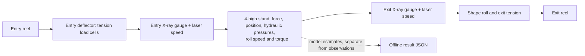

# Disconnected sensor and force-observation map (prototype 0.2)

This is a generic cold strip mill instrument taxonomy, **not an installed instrument list
for a real aluminium plant**. Each `artifacts/sensor_manifest.json` entry has a stable
`sensor_id`/`equipment_id`, generic X/Y/Z marker position in metres, physical quantity,
SI observation unit, observation type, source and data-quality note. All `raw_signal_value`,
`calibrated_observation_value_si`, `derived_estimate_value_si`, observed values and
UTC timestamps are `null`; quality is `unavailable` and origin is `no_plant_connection`.
Model estimates are stored in `model_estimate_si` separately. Unknown uncertainty,
filter delay and bandwidth remain `null`. The approximate travel time printed for a
marker is distance divided by a *steady* local speed, not a synchronized measurement or
transport-delay model. Material coordinates remain unknown until timestamp, sensor
position and line-speed alignment are established.

The Blender scene and USDA contain cyan marker spheres named `sensor_marker_<sensor_id>`.
Marker locations are schematic and must be surveyed on an actual stand. The equipment
registry is intentionally small; adding a type to it does not create a physics solver.

## Primary-source-backed instrument categories

| Type and location | What is observed; important qualification | Source |
|---|---|---|
| Entry/exit X-ray gauges | Direct beam/detector signal converted to local thickness; aluminium-specific alloy compensation and source health are required. Generic markers precede/follow the stand. | [Danieli HiTHIX X-ray gauge](https://www.danieli.com/en/products/products-processes-and-technologies/product-lines/hithix_26_115.htm). This page describes cold-strip systems but its examples are steel; no aluminium calibration is imported. |
| Stand load cells | A force on the instrumented load path, compared to bite separating force only after load-path calibration. | [Li et al. measured rolling load with two load cells](https://www.jstage.jst.go.jp/article/isijinternational/58/4/58_ISIJINT-2017-623/_html/-char/en); their sheet was stainless steel. |
| Cylinder position and cap/rod pressures | Position sensor directly measures actuator travel; two pressures and cylinder areas yield ideal differential thrust. Neither alone equals downstream gauge or bite force. | [DwyerOmega LVDT explanation](https://www.dwyeromega.com/en-us/resources/lvdt-sensors); [Danieli hydraulic AGC equipment](https://www.danieli.com/en/products/processes-technologies/product-lines/hydraulic-automatic-gap-control-cylinders_26_203.htm). |
| Strip tension load cells near deflector rolls | A bearing reaction is converted to strip force only after wrap angle, reaction axis and tare are known. Equal tension on both deflector sides is an extra approximation. | [ABB strip tension measurement](https://www.abb.com/global/en/areas/automation/measurement-analytics/force-measurement/strip-tension) and its [PillowBlock example](https://www.abb.com/global/en/areas/automation/measurement-analytics/force-measurement/strip-tension/pressductor-pillowblock-load-cells-pftl211). |
| Laser strip speed gauges | Direct strip surface speed before and after the bite, subject to local optics and synchronization. Roller-encoder speed alone can differ through slip. | [Polytec industrial strip velocimetry](https://www.polytec.com/en/velocimetry). |
| Work-roll rotary encoder | Shaft angular speed after gear-ratio/direction calibration; rolls need not equal strip surface speed. | [Encoder Products shaft encoders](https://www.encoder.com/). |
| Drive shaft torque or inferred motor torque | Distinguish instrumented shaft torque from electrical-current estimates that need motor, gear and loss calibration. The present solver's torque is energy-equivalent only. | [Kistler instrumentation](https://www.kistler.com/) is a generic vendor lead; a specific mill device was not verified here. |
| Flatness roll | Widthwise force or longitudinal-stress distribution and flatness units, not geometric crown or residual stress. No model estimate is emitted. | [ABB Stressometer measurement variants](https://www.abb.com/global/en/areas/automation/measurement-analytics/force-measurement/flatness-measurement/flatness-systems/flatness-measurement-system). |
| Infrared pyrometer | Surface temperature only after emissivity/reflection qualification for aluminium. It is not a uniform strip temperature or thermal-crown prediction. | [Fluke metal emissivity guidance](https://www.flukeprocessinstruments.com/en-us/service-and-support/knowledge-center/infrared-technology/emissivity-metals). |
| Roll-bending force | Actuator force must enter a roll-stack load-path model; the registry supplies no simulated bending. | [ABB flatness actuator context](https://www.abb.com/global/en/areas/automation/measurement-analytics/force-measurement/flatness-measurement/flatness-systems). |

Sensor examples are not procurement recommendations. Type, range, calibration curve,
raw units, sampling, bandwidth, filter settings, radiation safety requirements and exact
mounting must be provided for a real application. Cooling systems may use neat oil or other
lubricants, so this version has no universal emulsion concentration channel. Material flow,
force and heat pathways remain separately identified.

## Tested observation equations and limits

`physicroll/observations.py` implements the following SI helpers. They are conversion
identities or idealized instrument mechanics, **not additional independent rolling loads**:

| Equation | Interpretation and explicit limit |
|---|---|
| `sigma_tension = T / (b h_local)` | Convert force at the local entry/exit strip section; using the other gauge is wrong. |
| `m_dot = rho b h_local v_local` | Quasi-steady local mass flow. Entry/exit comparison of time records needs parcel alignment and storage/transient corrections. |
| `T = (R_sensor − tare) / [2 sin(wrap_angle/2)]` | Symmetric equal-tension deflector approximation. The helper rejects unqualified geometry and bad wrap/tare values. Bearing loads, friction and unequal adjacent tensions are not solved. |
| `F_cyl = p_cap pi r_cap² − p_rod pi(r_cap² − r_rod²)` | Ideal signed double-acting cylinder thrust. Seal friction, cylinder/roll-stack inertia, gravity, balancing, other cylinders and bending actuators need a calibrated load-path equation. `F_cyl` must not be added to bite force. |
| `forward_slip = (v_exit − u_roll)/u_roll` | Uses **measured** speeds when available; rejected near zero roll speed. The process model's `assumed_forward_slip_fraction` is not a measurement. |
| `M_shaft = s T r + I alpha + M_loss` | `s=+1` winding, `s=−1` paying out, positive local transport rotation. Acceleration and loss must be supplied. Steady snapshot evaluates `alpha=M_loss=0`; a real reel/strip transient is not simulated. |

The stand snapshot in `physicroll/equipment.py` uses a **synthetic effective whole-stand
stiffness** `K`: total stand reaction equals the existing bite separating force `F`, assumed
symmetric side reactions are `F/2`, extension is `F/K`, and implied unloaded gap is
`prescribed loaded gap − F/K`. Negative unloaded gaps are rejected for this simple
non-preloaded configuration. The loaded gap is equated with prescribed exit gauge only
under the rigid-strip demonstrator assumption. Recovered strip gauge is `null`. Roll
flattening is not separately added; doing so after fitting an effective stand stiffness
could double-count deformation. The same applied load cannot be counted again as a new
reaction or actuator force.

The reel snapshot takes synthetic radii/inertias from
`scenarios/baseline.equipment.json`. Entry torque is negative work on the strip
(braking/pay-out); exit torque is positive (winding). Their signed powers sum to the
process solver's net tension-power term. Rotational kinetic energies are shown at the
specified radii, but acceleration torque and motor losses are `null` in the snapshot.
No claim is made that `P_roll + P_reels` is total electrical demand.

In this demonstrator (the equipment and sensor registry: `physicroll/equipment.py`,
`physicroll/sensors.py`, `physicroll/observations.py`) roll-stack bending, thermal crown,
widthwise flatness, coolant/lubricant flow, coil-build kinematics, dynamics and control remain
interfaces: the registry names the instruments and converts readings, and nothing in it
simulates these effects. The band screening part of the repository (`docs/band-diagnosis.md`)
has since added models of some of them, all unvalidated and most of them switched on only by a
case key: a roll thermal model with spray cooling and the thermal crown across the barrel
(section 7.1), the strip shape and flatness across the width (section 7.2), what a shapemeter
and a thickness gauge would show (sections 7.6 and 11.6), a simulated spray-zone flatness loop
with the tool's own control rule (section 7.12), an emulated zone step test (section 7.1), a
linear chatter and mill-dynamics screen (sections 9 and 11) and a coil ridge screen. Roll-stack
bending is not modelled anywhere in the repository; neither is a plant's own flatness or gauge
controller. None of these models has been compared with plant data; the full list of what they
assume is in `docs/limitations.md`. See `docs/research.md` for scientific validation gates.
Tests are in `tests/test_equipment_sensors.py` and `tests/test_observations.py`.

## Measurement inputs of the band screening tool

The band screening tool (`python -m physicroll.band_cli`, and the guided app) takes the
measurements below. They are values a person types in or loads from a file; there is no live
plant connection, and the sensor manifest's readings above stay empty. Section numbers refer to
`docs/band-diagnosis.md`.

| Input (case key) | What is entered | What the tool does with it | The caution that matters most |
|---|---|---|---|
| Shapemeter (`measurement.shapemeter`), section 7.6 | zone width and positions, coverage, optional neighbour spreading and whether it corrects for strip temperature | shows what each zone would read for the modelled bands | the readings are zone means of a model, not a forecast of the operator's screen: no shapemeter dynamics, filter, noise, calibration or temperature compensation; the readings never change a score |
| Thickness gauge (`measurement.thickness_gauge`), section 11.6 | spot length and response time of the gauge | shows about how much of each mark spacing the gauge keeps | a spot average and a first-order lag only (real gauges have other filters); when the gauge cannot show a mark, a "no gauge variation" answer is flagged but the scores are not changed |
| Pass records (`measurement.pass_records`), section 8.5 | roll force (required), forward slip and torque where measured, with their uncertainties | works out the friction that reproduces them, per record | shown only and applied nowhere; the value absorbs the roll-gap model's own error (about 12 % from load and 30 % from slip on the published case), and the entered numbers are not verified |
| Strip temperature scan (`width_model.strip_temperature`), section 7.7 | an exit strip temperature profile across the width | adds the temperature part to flatness as measured hot and after cooling | the scan is an input, not computed; the expansion coefficient defaults to a textbook value, and without a controller the held-flat case is only a bound |
| Measured roll profile (`width_model.roll_ground_profile`), section 7.9 | the radius deviation of one work roll along the barrel from a grinder report | puts it through the same transfer as a hot roll stripe | one roll, measured cold and off the mill; narrow marks are smoothed; grinder gauges read diameter, so halve the deviations; never evidence |
| Grinder marks and settings (`kinematics.grinder_marks`), section 6.3 (rule 3) and section 7.9 | a counted number of marks around the roll, or the grinder's last-pass wheel (or vibration) and roll speeds | computes the mark count and tests the roll-mark spacing against it | without these data a grinder chatter pattern cannot be ruled out; no amplitude of grinder marks on foil rolls is published |
| Roll temperature scan or thermal camber (`--calibrate-spray` file), section 7.1 | roll surface temperatures after a stop, or a measured thermal camber, along the barrel | fits one circumferential-mean spray coefficient for the whole header and prints it | the fit carries the errors of the heat share and the other inputs taken from the case; it is never applied: you enter the value yourself |
